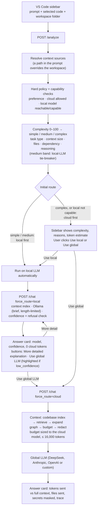

# TokenGuard

> **A local-first AI gateway for coding assistants.**
>
> Simple coding questions are answered by a small model on your machine. Hard ones go to a cloud LLM, with only the relevant, secret-redacted code attached, and only after you agree.

TokenGuard is not another coding LLM. It is the layer in front of the models that decides **where** each question is answered and **how much** of your code travels with it. It ships as a VS Code sidebar ("LocalPilot Assistant") backed by a small Python gateway.

---

## Why

Cloud-only coding assistants send every request, often with a large slice of the repository, to a remote model:

- A one-line regex question is billed like a multi-file refactor.
- A laptop that can run a small coding model sits idle while every question goes to the cloud.
- Source code, and the secrets in it, leave the machine by default.

TokenGuard sends each request to the cheapest, most private model that can answer it, and compresses the context before anything leaves the machine.

---

## Process flow



### Step by step

1. **Collect the request (sidebar).** The extension sends the prompt, the current editor selection (`code`) and the folder of the active file (`repo_path`).
2. **Resolve the context sources (gateway).** If the prompt contains an absolute path to an existing folder, that folder becomes the repo to search. If it names a file, the file is attached as code and its project root (nearest `.git`, `package.json`, `pyproject.toml`, …) is searched. In the prompt, a file path is replaced by the file name and a folder path is removed; a file named several times (say, in every frame of a traceback) is attached once. Otherwise the workspace folder is used.
3. **Analyze, no model called (`POST /analyze`).** The policy runs hard checks, local-model capability checks, then scores the task (0–100 → simple/medium/complex) and returns the initial route, the reasons, the files the context engine would select, and how many tokens the cloud would receive versus the full context.
4. **Decide the route.**
   - `local` (simple) and `local_first` (medium, capable): the sidebar runs the local LLM automatically, then escalates only if the answer looks unreliable.
   - `cloud` (complex, or not locally capable): the sidebar waits for the user to click **Use local LLM** or **Use global LLM (recommended)**.
5. **Run the chosen route (`POST /chat` with `force_route`).**
   - **Local:** the context engine builds the context, Ollama answers as JSON `{answer, confidence, needs_cloud, more_available}`, and the confidence is adjusted (very short answers and hedges such as "I'm not sure" lower it). Answers are **brief by default** (about `LOCAL_BRIEF_WORDS` words, hard-capped at `LOCAL_BRIEF_MAX_TOKENS`); when more would help, the card offers **More detailed explanation**, which re-asks with `detail: "detailed"`. Nothing leaves the machine.
   - **Global:** the context engine always runs right before the cloud call: it selects the relevant code, fits it into the token budget and masks secrets in both the code and the prompt. Only that slice is sent to the configured cloud provider. A failed call is shown as an error (or answered by the labelled mock when `CLOUD_FALLBACK_TO_MOCK=true`).
6. **Show the receipts.** The answer card shows the model, latency, confidence (local) or tokens sent / saved, files sent and secrets masked (global), plus a pipeline trace. A local answer always offers **Use global LLM**; it is highlighted when the backend flags `low_confidence` (confidence below `MIN_LOCAL_CONFIDENCE`, 0.7). Both frontends render the backend's routing and escalation decisions; neither recomputes them. The header shows backend and Ollama status and the session's local/cloud counts and tokens saved (`GET /health`, `GET /stats`).

### Routing policy

Three decisions are kept separate: the **routing preference** (`auto`/`local`/`cloud`; an explicit
`local` never auto-escalates), the **initial route** (hard policy + capability checks + complexity),
and the **post-response escalation**. A complexity score of `0..100` classifies the task:

| Factor | Weight | Signal |
|---|---|---|
| Task type | 25% | Keywords: `refactor`, `race condition`, `architecture` (hard) vs `explain`, `rename`, `regex` (easy) |
| Context size | 20% | Tokens of the *relevant* (optimized) context (8k+ tokens = 1.0) |
| Files | 20% | Files mentioned in the prompt and the size of the attached repo |
| Dependency scope | 20% | Cross-file markers: imports, modules, "throughout", "across the codebase" |
| Reasoning | 15% | Reasoning markers ("why", "trade-off", "step by step") and prompt length |

Simple (≤34) and medium (35–64) route local-first; complex (≥65) routes cloud-first. Before any of
that, the router checks whether the local model is reachable and capable (tool calling, context
window, multi-file), and applies hard policy: `local`/`cloud` preferences, `CLOUD_ENABLED`, and the
privacy switch `CLOUD_TRANSMISSION_PROHIBITED`. A clearly complex task keeps a floor of
`0.8 × task_type`, so a hard prompt with no code attached still reaches the strong model. Because
keywords are shallow, medium-band requests (35–64) can be re-classified by a zero-shot local-LLM
tie-breaker (`backend/classifier.py`, `LOCAL_LLM_CLASSIFIER`); simple/complex requests never hit it,
and a failure just falls back to the heuristic. Weights and boundaries are configurable heuristics,
not learned values. See
[`docs/routing-policy.md`](docs/routing-policy.md) and [`backend/ROUTING.md`](backend/ROUTING.md).

### Context engine

Deterministic and LLM-free (`compression/`):

1. **Walk** the repo, respecting `.gitignore` and skipping `node_modules`, build output, minified and binary files.
2. **Chunk** code into functions and classes (80-line windows where there are no symbols).
3. **Rank** chunks with IDF-weighted matches of the query terms in symbol names, paths and bodies. The query is the prompt plus the most frequent identifiers of the selected code, so vague prompts ("explain this") still find related files.
4. **Expand** one hop through the import graph.
5. **Budget:** a short summary of every relevant file first, then full bodies, then extra chunks, never repeating a line. The budget is chosen per request: the local window for local-bound requests, and for complex cloud-bound ones the cloud model's window minus room for the answer, capped at `CLOUD_MAX_CONTEXT_TOKENS` (16,000).
6. **Redact** secrets (AWS keys, OpenAI keys, GitHub tokens, private keys, connection strings, `password = "…"` style assignments).

If the engine fails, the router falls back to a simpler keyword-based optimizer so a request never breaks.

By default the repo context now comes from a **persistent, incremental codebase index**
(`compression/codeindex`, `CONTEXT_INDEX_ENABLED=true`): a SQLite symbol/edge index keyed by content
hash *and* a derivation environment (so a parser/resolver/model upgrade re-derives only what it must),
with uncertainty-aware edges (syntactic references are recorded but never asserted as dependencies)
and per-item provenance plus an adequacy verdict. Retrieval is hybrid (exact symbol, lexical, graph
expansion over confident edges, and semantic when an embedding model is available); corpus-wide
requests ("convert all the python code to typescript") get a signature map of every in-scope file.
The local model may only rerank a shortlist and propose missing names, which the index resolves.
It degrades to the in-memory engine above on any error. Design: [`docs/codebase-intelligence.md`](docs/codebase-intelligence.md).

### Agent mode

Pick **Agent** in the sidebar's *Mode* menu (global or local LLM) to have LocalPilot make changes, not just answer:

1. **Explore.** The model reads, lists and searches the workspace with tools, the same way a person would, before it changes anything.
2. **Edit.** It makes exact string edits (`edit_file`), line-range edits (`replace_lines`), whole-file writes (`write_file`) and appends (`append_file`), deletions (`delete_file`), renames/moves (`move_file`), and bulk regex refactors across files (`search_replace_all`); `read_multiple_files` reads several files in one call. Edits are **staged in the backend, never written to your files**.
3. **Verify.** It runs tests, builds or quick scripts (`run_command`) in a **sandbox copy of the workspace with its staged edits applied**: every file is copied, gitignored ones included (only `.git` is left out), dependency folders (`node_modules`, `.venv`, …) are symlinked, the workspace's venv is put on `PATH`, and provider API keys are removed from the environment. Before the first command, files that look like credentials (`.env`, private keys, gitignored files containing API keys, …) are listed and you choose **Include** or **Leave out**. Every command waits for **Run / Run all for this task / Skip** in the sidebar. If something fails, the agent fixes it and runs it again.
4. **Review.** Each modified file opens with the changes marked **in the file itself**, as in Cursor: removed lines in red, the new lines in green right below them, and **✓ Accept / ✗ Reject** above every change (plus *Accept all / Reject all* at the top). Accepting a change drops its red lines, rejecting drops the green ones; when every change in the file is decided it is saved. Until then the edit exists only in the unsaved editor buffer. The sidebar card lists every file with **Review in file**, **Diff** (side-by-side diff editor), **Accept** and **Reject**; a **new file is created** (and its folder) so it appears in the tree and opens with its added lines in green — rejecting it removes the file again; deleted files are only shown in the file when you click *Review in file*. If a file changed after the agent read it, you are asked first. Turn off the automatic in-file review with `tokenguard.agentInlineReview`.

Steps, tool output and approvals stream live into the card; **Stop** cancels the run without touching any file. On the global route, secrets in anything sent to the model are replaced with placeholders and restored in the agent's edits. The local route needs a tool-capable model. `qwen2.5-coder:7b` handles real tasks; models under ~7B (such as the default 1.5b) get a warning, because they often pick the wrong line or loop on the same failing edit. The loop guards against that: malformed tool calls and empty replies are sent back with instructions, failed edits list the matching lines, a repeated failing call stops the run with a clear message, and `finish` is refused while a changed Python/JSON file does not parse (compiled, never run). Files named in the prompt (for example in a pasted traceback) are given to the agent up front. Code: `backend/agent.py` (loop, approvals, secret masking), `backend/agent_tools.py` (staged workspace, sandbox, tools), `backend/agent_llm.py` (tool calling for OpenAI-compatible APIs, Anthropic and Ollama), `extension/src/inlineDiff.ts` (in-file review).

### Sidebar layout

The sidebar has three stacked panes — the **model panel** (status + cloud/local model pickers), the **conversation**, and the **composer** (mode + prompt). Drag the thin handle between two panes to resize them (or focus a handle and press ↑/↓); each pane keeps a minimum height and the sizes are remembered. The conversation pane flexes to fill the space left over, and the composer's prompt box grows with its pane. The page lives in `extension/media/chat/` (`index.html`, `main.css`, `main.js`).

---

## Repository layout

| Path | What |
|---|---|
| `backend/` | LLM gateway service (FastAPI): `analyzer.py` (complexity scoring), `routing.py` (routing/escalation policy), `router.py` (pipeline), `context.py` (path resolution + optimizer adapter), `llm.py` (Ollama + cloud clients), `main.py` (API). Also holds `.env`, `requirements.txt`, `ROUTING.md` |
| `backend/` (cont.) | `agent.py`, `agent_tools.py`, `agent_llm.py` (agent mode), `classifier.py` (local-LLM complexity tie-breaker), `config.py` (all settings, validated on startup), `cloud_catalog.py` / `model_catalog.py` (cloud and local model metadata) |
| `compression/` | Context compression: `adapter.py` (contract the gateway calls), `codeindex/` (persistent SQLite index, hybrid retrieval, adequacy), `context_engine/` (in-memory fallback: walker, chunker, selector, import graph, budget allocator, redaction) |
| `extension/` | VS Code extension (frontend): the LocalPilot sidebar (`src/extension.ts`) and the backend launcher (`src/backend.ts`) |
| `scripts/` | `setup.sh` (used by `make setup`), `stop.sh` (used by `make stop`), `streamlit_ui.py` (optional browser UI with the same flow as the sidebar), `smoke_test.py` (calls a running API) |
| `tests/` | Python tests: routing policy and escalation, router integration, codebase index, context engine, context eval, lifecycle |
| `bench/`, `run_demo.py`, `examples/` | Routing and context benchmarks with labelled query sets, a CLI demo and a generator for the demo repo |
| `docs/` | Context engine spec, routing policy, [codebase-intelligence architecture](docs/codebase-intelligence.md), benchmark notes, pipeline trace |

All Python runs from the repo root: `backend` and `compression` are sibling packages (`uvicorn backend.main:app`, `python -m compression.check_contract`).

### API

| Endpoint | Purpose |
|---|---|
| `POST /analyze` | `{prompt, code, repo_path, force_route?}` → decision, complexity, reasons, repo searched, files selected, token and cost estimate, plus the same routing metadata as `/chat`. No model called. |
| `POST /chat` | Same body + `force_route: auto \| local \| cloud` and `detail: brief \| detailed` → answer, route, model, confidence, `low_confidence`, `more_available`, `truncated`, tokens sent/saved, files, secrets masked, trace, plus routing metadata (`requested_route`, `initial_route`, `final_route`, `complexity`, `complexity_score_100`, `local_capable`, `capability_reasons`, `escalation_kind`) and `context_metadata` (retrieval coverage, adequacy, evidence) |
| `POST /chat/stream` | Same as `/chat`, streamed as Server-Sent Events: `start` {route, model} when a model begins answering, `delta` {text} per token chunk, `reset` {reason} if the text so far is discarded, then `done` {the `/chat` response} or `error` {status, message}. Sends a `: ping` comment every `SSE_HEARTBEAT_S` (15s) while idle. Used by the VS Code sidebar. |
| `POST /agent/stream` | Agent mode, as Server-Sent Events. Body `{prompt, repo_path, code, active_file, route: cloud \| local, history}`. Events: `start` {run_id, model}, `thought` {text}, `tool_call` {call_id, name, args}, `tool_result` {call_id, ok, output}, `changes` {staged file stats}, `approval` {request_id, command, cwd}, `approval_resolved`, then `done` {summary, changes: [{path, status, original, proposed, diff, additions, deletions}], commands, tokens} or `error`. Never writes to the repo. |
| `POST /agent/approve` | `{run_id, request_id, approved, always}`: answers an `approval` event (`always` approves the rest of the run's commands) |
| `GET /stats` | Session totals: local/cloud requests, escalations, tokens saved |
| `GET /health` | Backend status, Ollama reachability, active local model + available local models, active cloud provider/model, and whether its API key validated |
| `GET /models` | Installed local models + active/loaded one, host resources (RAM/swap/VRAM), and recommended models that fit and can be pulled |
| `GET /cloud/models` | Cloud models for the active provider: live ids (via the API key) merged with curated context/price metadata; falls back to the catalog without a key |
| `POST /models/pull` | Download a model with `ollama pull` in the background (`{model}`) |
| `PUT /local-model` | Switch the active local model (`{model, preload}`): unloads the previous one first so only one is in memory; `model: null` unloads all |

All endpoints also accept optional `X-LLM-Provider`, `X-LLM-Model`, `X-LLM-Api-Key`, `X-LLM-Base-Url` and `X-Local-Model` headers (used by the VS Code extension) to override the `.env` settings for that request.

---

## Getting started

### Prerequisites

- [Ollama](https://ollama.com/) installed. `make setup` starts it and pulls the local model (default `qwen2.5-coder:1.5b`, set `LOCAL_MODEL` to change).
- Python 3.9+
- VS Code 1.82+, and Node.js 18+ to rebuild the extension (`extension/out/` is committed)
- An API key for the global LLM. Set it either in `backend/.env`, or from VS Code with **TokenGuard: Set Cloud API Key** (stored in SecretStorage). Without a valid key the request errors (unless `CLOUD_FALLBACK_TO_MOCK=true`, which answers with a clearly-labeled mock).

### One command

```bash
make dev                      # or: make dev WORKSPACE=/path/to/project-to-ask-about
```

This runs `scripts/setup.sh` (idempotent: re-runs skip finished steps) and then opens VS Code with the extension loaded:

1. Creates `.venv/` and installs `requirements.txt` (reinstalls only when a requirements file changes).
2. Creates `backend/.env` from `.env.example` if missing. Put a key there, or set one from VS Code with **TokenGuard: Set Cloud API Key** (see below).
3. Starts `ollama serve` if Ollama isn't reachable, and pulls `LOCAL_MODEL` if it isn't downloaded.
4. Runs `npm install` (when needed) and compiles the extension.

The extension then **starts the backend itself** as a child process (`.venv/bin/python -m uvicorn backend.main:app` from the repo root) and stops it when VS Code closes. If something already answers on `tokenguard.apiUrl` (e.g. `make backend`), it reuses that and leaves it running. It also **starts Ollama if it isn't running** and stops it again on exit (see *Process cleanup* below). Backend logs: **Output → LocalPilot Backend**. Commands: **TokenGuard: Restart Backend**, **TokenGuard: Show Backend Log**, **TokenGuard: Set Cloud API Key**, **TokenGuard: Clear Cloud API Key**, **TokenGuard: Download Local Model**, **TokenGuard: Unload Local Models**.

| Command | What it does |
|---|---|
| `make dev` | setup + open VS Code with the extension (backend auto-starts) |
| `make setup` | setup only (`SKIP_OLLAMA=1`, `SKIP_EXTENSION=1`, `PYTHON=python3.11` to tweak) |
| `make backend` | setup + run the API in the foreground with `--reload` (`PORT=8000`) |
| `make test` | run the Python tests |

Extension settings: `tokenguard.apiUrl` (default `http://localhost:8000`), `tokenguard.autoStartBackend` (default `true`), `tokenguard.backendPath` and `tokenguard.pythonPath` (empty = the repo's `backend/` and `.venv/`), plus `tokenguard.cloudProvider` (`deepseek`/`anthropic`/`openai`/`custom`/`mock`), `tokenguard.cloudModel` (empty = provider default), `tokenguard.customBaseUrl` (for the `custom` provider, e.g. Groq/OpenRouter), `tokenguard.cloudModelsAutoFetch` (fetch the provider's model list for the picker) and `tokenguard.localModel` (empty = `LOCAL_MODEL` from `.env`). The sidebar's **Cloud** section picks the provider and model (from `GET /cloud/models`, which lists the provider's live models merged with curated context/price metadata), stores the API key inline in SecretStorage, and has a **Test connection** button. `/analyze` returns an `estimated_cost_usd` and `/stats` a `total_cost_usd` (real cloud calls only). Ollama lifecycle: `tokenguard.ollamaUrl` (default `http://localhost:11434`), `tokenguard.autoStartOllama` (default `true`), `tokenguard.preloadLocalModel` (default `true`, loads the selected model on startup) and `tokenguard.stopOllamaOnExit` (default `true`). The sidebar's **Local model** dropdown lists the models Ollama has pulled plus **recommended models that fit this machine** (from `GET /models`, based on detected RAM/swap/VRAM); recommended ones are marked "needs download" and offer to pull when selected. Your pick is saved to `tokenguard.localModel`; changing it unloads the previously loaded model and preloads the new one (`PUT /local-model`) so only one local model is in memory at a time. You can also run **TokenGuard: Download Local Model** and **TokenGuard: Unload Local Models** from the command palette.

**Process cleanup.** On exit the extension stops everything it started: the backend process, the local model(s) held in memory (so the multi-GB RAM/VRAM is freed), and the `ollama serve` it launched. The backend also unloads **every** model Ollama reports as resident on shutdown (not just the one it used), so models loaded by the classifier, reranker or embedding backend don't linger. An Ollama that was already running (e.g. a systemd service, or one `setup.sh` found running) is **left alone** — only its loaded models are unloaded. If `setup.sh` started `ollama serve`, it records the PID in `.ollama.pid` so the extension can stop that exact process. Set `tokenguard.stopOllamaOnExit=false` to keep the extension-managed Ollama running.

For runs **outside** the extension (`make backend`, or a crashed session) run:

```bash
make stop        # unload all local models + stop the Ollama that setup.sh started
```

It reads the same `.ollama.pid` marker and never kills an external Ollama.

**API keys** live in VS Code's SecretStorage, not in any file. Run **TokenGuard: Set Cloud API Key** to pick a provider and paste its key; the extension sends the provider, model and key to the backend as request headers (`X-LLM-Provider` / `X-LLM-Model` / `X-LLM-Api-Key`), overriding `backend/.env` for that request only. `GET /health` reports whether the active key actually validated (`cloud_valid`, `cloud_detail`).

To work on the extension itself, open `extension/` in VS Code and press `F5` instead of `make dev`.

### Optional

```bash
streamlit run scripts/streamlit_ui.py     # browser UI with the same flow (TOKENGUARD_API_URL overrides http://localhost:8000)
python examples/seed_demo_repo.py         # creates examples/frozen_repo, a small TS repo with an auth module
python run_demo.py                        # context engine CLI demo on that repo
python -m pytest tests                    # all Python tests (same as make test)
```

### Configuration (`backend/.env`)

| Variable | Default | Meaning |
|---|---|---|
| `CLOUD_PROVIDER` | `deepseek` | `deepseek`, `anthropic`, `openai`, `custom` (any OpenAI-compatible API) or `mock` |
| `CLOUD_FALLBACK_TO_MOCK` | `false` | If `true`, answer with the mock when the global LLM call fails; by default failures are surfaced as errors |
| `CLOUD_HEALTHCHECK_TTL_S` | `60` | Seconds a `/health` provider credential check is cached before re-pinging |
| `CLOUD_MODELS_TTL_S` | `300` | Seconds a provider `/models` listing is cached before re-fetching |
| `DEFAULT_OUTPUT_TOKENS_ESTIMATE` | `600` | Assumed output tokens used only for the pre-send cost estimate in `/analyze` |
| `DEEPSEEK_API_KEY` | `your-deepseek-api-key` (placeholder) | Your DeepSeek key |
| `DEEPSEEK_URL`, `DEEPSEEK_MODEL` | `https://api.deepseek.com/chat/completions`, `deepseek-chat` (DeepSeek-V3) | DeepSeek endpoint and model (output capped at 8,192 tokens) |
| `ANTHROPIC_API_KEY`, `ANTHROPIC_MODEL` | – , `claude-sonnet-5-5` | Anthropic settings |
| `OPENAI_API_KEY`, `OPENAI_BASE_URL`, `OPENAI_MODEL` | – , OpenAI, `gpt-4o-mini` | OpenAI settings |
| `CUSTOM_API_KEY`, `CUSTOM_BASE_URL`, `CUSTOM_MODEL` | – | Custom OpenAI-compatible endpoint (Groq/OpenRouter/self-hosted); also settable per request via `X-LLM-Base-Url` |
| `OLLAMA_URL`, `LOCAL_MODEL` | `http://localhost:11434`, `qwen2.5-coder:1.5b` | Local model |
| `LOCAL_KEEP_ALIVE` | `30m` | How long the active local model stays resident. Only one is loaded at a time; switching unloads the previous model first |
| `LOCAL_TIMEOUT_S` | `120` | Max wait between streamed chunks from the local model |
| `LOCAL_BRIEF_WORDS`, `LOCAL_BRIEF_MAX_TOKENS` | `200`, `1200` | Length budget and hard cap for a normal local answer |
| `LOCAL_DETAILED_WORDS`, `LOCAL_DETAILED_MAX_TOKENS` | `800`, `4000` | The same for **More detailed explanation** |
| `DEFAULT_ROUTE` | `auto` | Routing preference when a request doesn't set one: `auto`, `local` or `cloud` |
| `CLOUD_ENABLED`, `CLOUD_TRANSMISSION_PROHIBITED` | `true`, `false` | Cloud master switch, and the hard privacy switch (nothing leaves the machine) |
| `COMPLEXITY_WEIGHTS`, `COMPLEXITY_SIMPLE_MAX`, `COMPLEXITY_MEDIUM_MAX` | see `.env.example`, `34`, `64` | Complexity factor weights (JSON) and the 0–100 category boundaries |
| `LOCAL_LLM_CLASSIFIER` | `true` | Use the local model as a tie-breaker for medium-band requests |
| `MIN_LOCAL_CONFIDENCE` | `0.7` | Below this, a local answer is escalated (`auto`) or flagged `low_confidence` |
| `ESCALATION_ENABLED`, `MAX_CLOUD_ESCALATIONS`, `MISSING_CONFIDENCE_POLICY` | `true`, `1`, `escalate` | Post-response escalation |
| `CLOUD_MAX_CONTEXT_TOKENS` | `16000` | Cap on context sent to a cloud model |
| `CLOUD_CONTEXT_TOKEN_BUDGET` | `3000` | Fallback context budget when none is computed for the request |
| `CONTEXT_INDEX_ENABLED`, `CONTEXT_LLM_ASSIST`, `CONTEXT_SEMANTIC_ENABLED` | `true` | Codebase index, local-model rerank/propose, and semantic retrieval (each fails open) |
| `AGENT_MAX_STEPS`, `AGENT_COMMAND_TIMEOUT_S` | `30`, `180` | Agent: model calls per task, and the per-command time limit |
| `AGENT_AUTO_APPROVE_COMMANDS` | `false` | Run agent commands without asking (they still run only in the sandbox copy) |
| `AGENT_SHADOW_MAX_MB`, `AGENT_CONTEXT_TOKENS`, `AGENT_LOCAL_NUM_CTX` | `300`, `60000`, `16384` | Largest repo the sandbox copies, transcript budget before old tool output is elided, local agent context window |
| `AGENT_LOCAL_TIMEOUT_S` | `600` | Max wait for the next chunk of a local agent step (covers a cold model load on CPU) |

Every setting, with comments, is in [`backend/.env.example`](backend/.env.example).

---

## Measured results

Token counts from our runs on the `final_features` code (tiktoken `cl100k`, codebase index on,
local model `qwen2.5-coder:1.5b` on an 8-core CPU without a GPU). "Full context" is the prompt plus
every source file of the attached repo, which is what a cloud-only assistant could send.

| Prompt | Repo | Route | Full context | Sent to cloud | Saved |
|---|---|---|---:|---:|---:|
| Write a regex to match an email address | none | Local (`qwen2.5-coder:1.5b`, 22 s, confidence 0.9) | 8 | 0 | 100% |
| Refactor the auth architecture across the whole codebase | this repo | Global (complex, 80/100) | 116,062 | 14,398 | 88% |
| Explain the auth schema | `frozen_repo` | Global | 2,605 | 819 | 69% |
| Find and fix a race condition in the user service | `frozen_repo` | Global (complex, 80/100) | 2,610 | 824 | 68% |

The global answers in these runs came from the mock provider; the token savings do not depend on
which cloud model answers. Cloud-bound requests now get a context budget sized to the cloud
model (up to 16,000 tokens) instead of a fixed 3,000, so they carry more of the relevant code.
On the small `frozen_repo` that means a lower percentage saved than earlier 3,000-token runs.

**Known limitation:** with a large repo attached, a CPU-only machine can take longer than
`LOCAL_TIMEOUT_S` (120 s) to read a ~7.7k-token local context with the 1.5B model. The local call
then fails and an `auto` request escalates to the cloud. On such machines, raise `LOCAL_TIMEOUT_S`
or lower `LOCAL_MAX_CONTEXT_TOKENS`.

---|---|---:|---:|---:|
| Write a regex to match an email address | Local (`qwen2.5-coder:7b`, 28 s) | 24,812 | 0 | 100% |
| Refactor the auth architecture across the whole codebase | Global | 24,814 | 2,982 | 88% |
| Explain the auth schema (`frozen_repo`) | Global | 2,604 | 502 | 81% |
| Find and fix a race condition in the user service (`frozen_repo`) | Global | 2,610 | 587 | 78% |

The global answers in these runs came from the mock provider; the token savings do not depend on which cloud model answers.

---

## Roadmap

Done: VS Code sidebar, local and cloud LLM clients (DeepSeek, Anthropic, OpenAI, custom), explainable routing policy (hard policy, capability checks, 0–100 complexity, local-LLM tie-breaker) with user consent, escalation on confidence, refusals and errors, length-limited local answers with **More detail**, persistent codebase index with hybrid retrieval and adequacy checks, token and cost measurement, secret redaction, session stats, clean process shutdown.

Next:

- Response cache (prompt + code hash in SQLite)
- Learn the router from logged decisions and "Use global LLM" retries
- Savings dashboard in the sidebar
- AST-based (Tree-sitter) chunking for more languages

---

## Positioning

**TokenGuard is not a coding LLM. It is the inference layer that decides where your tokens go.**

- Keep simple work on-device
- Escalate only when necessary, and only with the user's consent
- Send only the context that matters
- Keep secrets off the wire
