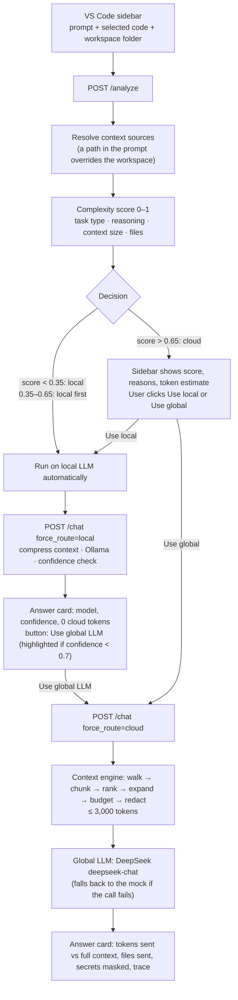

# TokenGuard

> **A local-first AI gateway for coding assistants.**
>
> Simple coding questions are answered by a small model on your machine. Hard ones go to a cloud LLM, with only the relevant, secret-redacted code attached, and only after you agree.

TokenGuard is not another coding LLM. It is the layer in front of the models that decides **where** each question is answered and **how much** of your code travels with it. It ships as a VS Code sidebar ("LocalPilot Assistant") backed by a small Python gateway.

---

## Why

Cloud-only coding assistants send every request, often with a large slice of the repository, to a remote model:

- A one-line regex question is billed like a multi-file refactor.
- A laptop that can run a 7B coding model sits idle while every question goes to the cloud.
- Source code, and the secrets in it, leave the machine by default.

TokenGuard sends each request to the cheapest, most private model that can answer it, and compresses the context before anything leaves the machine.

---

## Process flow



### Step by step

1. **Collect the request (sidebar).** The extension sends the prompt, the current editor selection (`code`) and the folder of the active file (`repo_path`).
2. **Resolve the context sources (gateway).** If the prompt contains an absolute path to an existing folder, that folder becomes the repo to search. If it names a file, the file is attached as code and its project root (nearest `.git`, `package.json`, `pyproject.toml`, …) is searched. The path text is removed from the prompt. Otherwise the workspace folder is used.
3. **Analyze, no model called (`POST /analyze`).** The analyzer scores the task from 0 to 1 and returns the decision, the reasons, the files the context engine would select, and how many tokens the cloud would receive versus the full context.
4. **Decide the route.**
   - `local` (score < 0.35) and `local_first` (0.35–0.65): the sidebar runs the local LLM automatically.
   - `cloud` (score > 0.65): the sidebar waits for the user to click **Use local LLM** or **Use global LLM (recommended)**.
5. **Run the chosen route (`POST /chat` with `force_route`).**
   - **Local:** the context engine builds the context, Ollama answers as JSON `{answer, confidence, needs_cloud}`, and the confidence is adjusted (very short answers and hedges such as "I'm not sure" lower it). Nothing leaves the machine.
   - **Global:** the context engine always runs right before the cloud call: it selects the relevant code, fits it into the token budget and masks secrets in both the code and the prompt. Only that slice is sent to DeepSeek (`deepseek-chat`). If that call fails, the mock answers instead and the card shows why.
6. **Show the receipts.** The answer card shows the model, latency, confidence (local) or tokens sent / saved, files sent and secrets masked (global), plus a pipeline trace. A local answer always offers **Use global LLM**; it is highlighted when confidence is below 0.7. The header shows backend and Ollama status and the session's local/cloud counts and tokens saved (`GET /health`, `GET /stats`).

### Routing score

| Factor | Weight | Signal |
|---|---|---|
| Task type | 40% | Keywords: `refactor`, `race condition`, `architecture` (hard) vs `explain`, `rename`, `regex` (easy) |
| Reasoning | 20% | Reasoning markers ("why", "trade-off", "step by step") and prompt length |
| Context size | 20% | Tokens of selected code + repo (8k+ tokens = 1.0) |
| Files | 20% | Files mentioned in the prompt and the size of the attached repo |

A clearly complex task keeps a floor of `0.8 × task_type`, so a hard prompt with no code attached still reaches the strong model. Rules were chosen over a trained classifier so every decision comes with readable reasons. See [`backend/ROUTING.md`](backend/ROUTING.md) for worked examples.

### Context engine

Deterministic and LLM-free (`compression/`):

1. **Walk** the repo, respecting `.gitignore` and skipping `node_modules`, build output, minified and binary files.
2. **Chunk** code into functions and classes (80-line windows where there are no symbols).
3. **Rank** chunks with IDF-weighted matches of the query terms in symbol names, paths and bodies. The query is the prompt plus the most frequent identifiers of the selected code, so vague prompts ("explain this") still find related files.
4. **Expand** one hop through the import graph.
5. **Budget:** a short summary of every relevant file first, then full bodies, then extra chunks, never repeating a line, within `CLOUD_CONTEXT_TOKEN_BUDGET` (3,000 tokens by default).
6. **Redact** secrets (AWS keys, OpenAI keys, GitHub tokens, private keys, connection strings, `password = "…"` style assignments).

If the engine fails, the router falls back to a simpler keyword-based optimizer so a request never breaks.

---

## Repository layout

| Path | What |
|---|---|
| `backend/` | LLM gateway service (FastAPI): `analyzer.py`, `router.py`, `context.py` (path resolution + optimizer adapter), `llm.py` (Ollama + cloud clients), `main.py` (API). Also holds `.env`, `requirements.txt`, `ROUTING.md` |
| `compression/` | Context compression engine: `adapter.py` (contract the gateway calls), `context_engine/` (walker, chunker, selector, import graph, budget allocator, redaction) |
| `extension/` | VS Code extension (frontend): the LocalPilot sidebar (`src/extension.ts`) and the backend launcher (`src/backend.ts`) |
| `scripts/` | `setup.sh` (used by `make setup`), `streamlit_ui.py` (optional browser UI with the same flow as the sidebar), `smoke_test.py` (calls a running API) |
| `tests/` | Context engine tests |
| `bench/`, `run_demo.py`, `examples/` | Benchmarks, a CLI demo and a generator for the demo repo |

All Python runs from the repo root: `backend` and `compression` are sibling packages (`uvicorn backend.main:app`, `python -m compression.check_contract`).
| `docs/` | Context engine spec, benchmark notes, pipeline trace |

### API

| Endpoint | Purpose |
|---|---|
| `POST /analyze` | `{prompt, code, repo_path}` → decision, score, reasons, repo searched, files selected, token estimate. No model called. |
| `POST /chat` | Same body + `force_route: auto \| local \| cloud` → answer, route, model, confidence, tokens sent/saved, files, secrets masked, trace |
| `GET /stats` | Session totals: local/cloud requests, escalations, tokens saved |
| `GET /health` | Backend status, Ollama reachability, active local model + available local models, active cloud provider/model, and whether its API key validated |
| `GET /models` | Installed local models + active/loaded one, host resources (RAM/swap/VRAM), and recommended models that fit and can be pulled |
| `GET /cloud/models` | Cloud models for the active provider: live ids (via the API key) merged with curated context/price metadata; falls back to the catalog without a key |
| `POST /models/pull` | Download a model with `ollama pull` in the background (`{model}`) |
| `PUT /local-model` | Switch the active local model (`{model, preload}`): unloads the previous one first so only one is in memory; `model: null` unloads all |

All endpoints also accept optional `X-LLM-Provider`, `X-LLM-Model`, `X-LLM-Api-Key`, `X-LLM-Base-Url` and `X-Local-Model` headers (used by the VS Code extension) to override the `.env` settings for that request.

---

## Getting started

### Prerequisites

- [Ollama](https://ollama.com/) installed. `make setup` starts it and pulls the local model (default `qwen2.5-coder:1.5b`, set `LOCAL_MODEL` to change).
- Python 3.9+
- VS Code 1.82+, and Node.js 18+ to rebuild the extension (`extension/out/` is committed)
- An API key for the global LLM. Set it either in `backend/.env`, or from VS Code with **TokenGuard: Set Cloud API Key** (stored in SecretStorage). Without a valid key the request errors (unless `CLOUD_FALLBACK_TO_MOCK=true`, which answers with a clearly-labeled mock).

### One command

```bash
make dev                      # or: make dev WORKSPACE=/path/to/project-to-ask-about
```

This runs `scripts/setup.sh` (idempotent: re-runs skip finished steps) and then opens VS Code with the extension loaded:

1. Creates `.venv/` and installs `requirements.txt` (reinstalls only when a requirements file changes).
2. Creates `backend/.env` from `.env.example` if missing. Put a key there, or set one from VS Code with **TokenGuard: Set Cloud API Key** (see below).
3. Starts `ollama serve` if Ollama isn't reachable, and pulls `LOCAL_MODEL` if it isn't downloaded.
4. Runs `npm install` (when needed) and compiles the extension.

The extension then **starts the backend itself** as a child process (`.venv/bin/python -m uvicorn backend.main:app` from the repo root) and stops it when VS Code closes. If something already answers on `tokenguard.apiUrl` (e.g. `make backend`), it reuses that and leaves it running. It also **starts Ollama if it isn't running** and stops it again on exit (see *Process cleanup* below). Backend logs: **Output → LocalPilot Backend**. Commands: **TokenGuard: Restart Backend**, **TokenGuard: Show Backend Log**, **TokenGuard: Set Cloud API Key**, **TokenGuard: Clear Cloud API Key**, **TokenGuard: Download Local Model**, **TokenGuard: Unload Local Models**.

| Command | What it does |
|---|---|
| `make dev` | setup + open VS Code with the extension (backend auto-starts) |
| `make setup` | setup only (`SKIP_OLLAMA=1`, `SKIP_EXTENSION=1`, `PYTHON=python3.11` to tweak) |
| `make backend` | setup + run the API in the foreground with `--reload` (`PORT=8000`) |
| `make test` | run the Python tests |

Extension settings: `tokenguard.apiUrl` (default `http://localhost:8000`), `tokenguard.autoStartBackend` (default `true`), `tokenguard.backendPath` and `tokenguard.pythonPath` (empty = the repo's `backend/` and `.venv/`), plus `tokenguard.cloudProvider` (`deepseek`/`anthropic`/`openai`/`custom`/`mock`), `tokenguard.cloudModel` (empty = provider default), `tokenguard.customBaseUrl` (for the `custom` provider, e.g. Groq/OpenRouter), `tokenguard.cloudModelsAutoFetch` (fetch the provider's model list for the picker) and `tokenguard.localModel` (empty = `LOCAL_MODEL` from `.env`). The sidebar's **Cloud** section picks the provider and model (from `GET /cloud/models`, which lists the provider's live models merged with curated context/price metadata), stores the API key inline in SecretStorage, and has a **Test connection** button. `/analyze` returns an `estimated_cost_usd` and `/stats` a `total_cost_usd` (real cloud calls only). Ollama lifecycle: `tokenguard.ollamaUrl` (default `http://localhost:11434`), `tokenguard.autoStartOllama` (default `true`), `tokenguard.preloadLocalModel` (default `true`, loads the selected model on startup) and `tokenguard.stopOllamaOnExit` (default `true`). The sidebar's **Local model** dropdown lists the models Ollama has pulled plus **recommended models that fit this machine** (from `GET /models`, based on detected RAM/swap/VRAM); recommended ones are marked "needs download" and offer to pull when selected. Your pick is saved to `tokenguard.localModel`; changing it unloads the previously loaded model and preloads the new one (`PUT /local-model`) so only one local model is in memory at a time. You can also run **TokenGuard: Download Local Model** and **TokenGuard: Unload Local Models** from the command palette.

**Process cleanup.** On exit the extension stops everything it started: the backend process, the local model(s) held in memory (so the multi-GB RAM/VRAM is freed), and the `ollama serve` it launched. An Ollama that was already running (e.g. a systemd service, or one `setup.sh` found running) is **left alone** — only its loaded models are unloaded. If `setup.sh` started `ollama serve`, it records the PID in `.ollama.pid` so the extension can stop that exact process. Set `tokenguard.stopOllamaOnExit=false` to keep the extension-managed Ollama running.

**API keys** live in VS Code's SecretStorage, not in any file. Run **TokenGuard: Set Cloud API Key** to pick a provider and paste its key; the extension sends the provider, model and key to the backend as request headers (`X-LLM-Provider` / `X-LLM-Model` / `X-LLM-Api-Key`), overriding `backend/.env` for that request only. `GET /health` reports whether the active key actually validated (`cloud_valid`, `cloud_detail`).

To work on the extension itself, open `extension/` in VS Code and press `F5` instead of `make dev`.

### Optional

```bash
streamlit run scripts/streamlit_ui.py     # browser UI with the same flow
python examples/seed_demo_repo.py         # creates examples/frozen_repo, a small TS repo with an auth module
python run_demo.py                        # context engine CLI demo on that repo
python -m pytest tests                    # context engine tests
```

### Configuration (`backend/.env`)

| Variable | Default | Meaning |
|---|---|---|
| `CLOUD_PROVIDER` | `deepseek` | `deepseek`, `anthropic`, `openai`, `custom` (any OpenAI-compatible API) or `mock` |
| `CLOUD_FALLBACK_TO_MOCK` | `false` | If `true`, answer with the mock when the global LLM call fails; by default failures are surfaced as errors |
| `CLOUD_HEALTHCHECK_TTL_S` | `60` | Seconds a `/health` provider credential check is cached before re-pinging |
| `CLOUD_MODELS_TTL_S` | `300` | Seconds a provider `/models` listing is cached before re-fetching |
| `DEFAULT_OUTPUT_TOKENS_ESTIMATE` | `600` | Assumed output tokens used only for the pre-send cost estimate in `/analyze` |
| `DEEPSEEK_API_KEY` | `your-deepseek-api-key` (placeholder) | Your DeepSeek key |
| `DEEPSEEK_URL`, `DEEPSEEK_MODEL` | `https://api.deepseek.com/chat/completions`, `deepseek-chat` (DeepSeek-V3) | DeepSeek endpoint and model (output capped at 8,192 tokens) |
| `ANTHROPIC_API_KEY`, `ANTHROPIC_MODEL` | – , `claude-sonnet-5-5` | Anthropic settings |
| `OPENAI_API_KEY`, `OPENAI_BASE_URL`, `OPENAI_MODEL` | – , OpenAI, `gpt-4o-mini` | OpenAI settings |
| `CUSTOM_API_KEY`, `CUSTOM_BASE_URL`, `CUSTOM_MODEL` | – | Custom OpenAI-compatible endpoint (Groq/OpenRouter/self-hosted); also settable per request via `X-LLM-Base-Url` |
| `OLLAMA_URL`, `LOCAL_MODEL` | `http://localhost:11434`, `qwen2.5-coder:1.5b` | Local model |
| `LOCAL_KEEP_ALIVE` | `30m` | How long the active local model stays resident. Only one is loaded at a time; switching unloads the previous model first |
| `LOCAL_THRESHOLD`, `CLOUD_THRESHOLD` | `0.35`, `0.65` | Routing thresholds |
| `MIN_LOCAL_CONFIDENCE` | `0.7` | Below this, a local answer is flagged for the global LLM |
| `CLOUD_CONTEXT_TOKEN_BUDGET` | `3000` | Max context tokens sent to the cloud |

---

## Measured results

Token counts from our runs (tiktoken `cl100k`). "Full context" is the prompt plus every source file in the repo, which is what a cloud-only assistant could send.

| Prompt | Route | Full context | Sent to cloud | Saved |
|---|---|---:|---:|---:|
| Write a regex to match an email address | Local (`qwen2.5-coder:7b`, 28 s) | 24,812 | 0 | 100% |
| Refactor the auth architecture across the whole codebase | Global | 24,814 | 2,982 | 88% |
| Explain the auth schema (`frozen_repo`) | Global | 2,604 | 502 | 81% |
| Find and fix a race condition in the user service (`frozen_repo`) | Global | 2,610 | 587 | 78% |

The global answers in these runs came from the mock provider; the token savings do not depend on which cloud model answers.

---

## Roadmap

Done: VS Code sidebar, local and cloud LLM clients, rule-based router with user consent, confidence-based escalation, token measurement, context selection and compression, secret redaction, session stats.

Next:

- Response cache (prompt + code hash in SQLite)
- Learn the router from logged decisions and "Use global LLM" retries
- Savings dashboard in the sidebar
- AST-based (Tree-sitter) chunking for more languages

---

## Positioning

**TokenGuard is not a coding LLM. It is the inference layer that decides where your tokens go.**

- Keep simple work on-device
- Escalate only when necessary, and only with the user's consent
- Send only the context that matters
- Keep secrets off the wire
