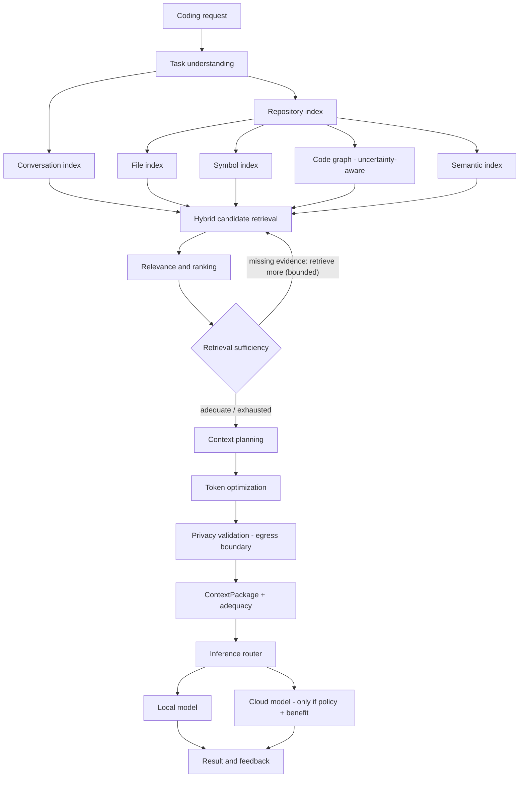

# LocalPilot: Codebase Intelligence & Context Optimization — Design

Status: design (no implementation yet). Audience: whoever builds/extends the retrieval and
routing subsystems.

This document defines the long-term architecture for how LocalPilot understands a repository,
assembles the evidence a task needs, and hands that evidence to the inference router. It is the
plan of record; individual stages are separate, independently shippable changes.

> **Revision note.** Four properties are treated as first-class and shape the whole design, not
> final integration tasks: (1) rigorous derived-data invalidation via a *derivation environment*,
> not just content hashes; (2) an *honest* graph that distinguishes syntactic references from
> resolved dependencies; (3) *retrieval sufficiency decoupled from routing escalation*; and
> (4) **security, evaluation and provenance as cross-cutting requirements** (§8). The index
> (SQLite), hybrid retrieval, source-grounded evidence, bounded local-model assistance, token-aware
> planning and the versioned interface are retained from the prior draft.

## 1. Purpose and scope

LocalPilot is treated internally as **two related engines**:

1. **Codebase intelligence engine** — builds and maintains an up-to-date model of the repository
   and retrieves the evidence required for a task. It must stay useful if Ollama, the cloud
   provider, or the coding model are replaced.
2. **Inference optimization engine** — decides which model acts on that evidence and how much
   context to provide (local vs cloud, escalation, budgets, privacy). It consumes context
   *metadata* and must not depend on index internals.

The governing principle: the system must know **what it retrieved, why, how reliable its
relationships are, what it omitted, and whether the evidence is adequate for the task.** Once those
are explicit, model routing and token efficiency become tractable.

In scope: repository indexing and invalidation, retrieval, sufficiency, context planning,
provenance, security, evaluation, and the boundary to the router.
Out of scope: model training, changing cloud providers, and the VS Code/Streamlit presentation
layer (beyond exposing metadata the router already returns).

### Non-goals / explicit constraints

- No graph database. SQLite tables for nodes/edges are simpler to debug and migrate; the graph
  layer sits behind an interface so storage can change later.
- **The engine never routes and never escalates.** It retrieves and reports adequacy; the router
  decides model, escalation and transmission.
- **No LLM-only truth.** LLM output about the codebase is derived data, always rebuildable and
  never the source of truth.

## 2. Core principles

1. **Source code is the authority.** Files (content-addressed by hash) are truth. Symbols, edges,
   embeddings, summaries and LLM interpretations are **derived** and must be traceable to a
   `file:line` and rebuildable when the repo changes.
2. **Derived data is keyed by a derivation environment, not just a content hash.** A hash answers
   "did the source change?"; it cannot answer "did the parser, grammar, resolver, chunker, embedding
   model or redaction ruleset change?". Both must match for a derived artifact to be reusable
   (§5.1). A global upgrade of any component triggers selective re-derivation of the affected
   artifact *kind*, never a blind full reindex and never silent staleness.
3. **The graph is honest about uncertainty.** A syntactic reference is not a runtime dependency.
   Every edge records how it was derived and how much to trust it; consumers must be able to say
   "this is a candidate, not a fact" (§5.3).
4. **Retrieval sufficiency is decoupled from routing.** Sufficiency decides only whether to
   *retrieve more evidence*; escalation is a separate router decision based on policy and expected
   benefit (§6.4–§6.5, §7).
5. **Evidence before inference.** Deterministic tools (index, graph, tokenizer, secret scanner) do
   what they are good at; the local model interprets ambiguity and *proposes*, and the index
   resolves/authorizes.
6. **Security, evaluation and provenance are cross-cutting.** They are designed into every stage,
   enforced at boundaries, and tested continuously (§8).
7. **Metadata crosses the boundary, not implementation.** The router sees a small, stable view;
   the engine sees nothing about models, keys or providers.

## 3. Target architecture



Two deliberate properties: the sufficiency loop only **retrieves**, and the escalation decision is
made **only** by the router after receiving the package.

## 4. Current state (baseline to evolve from)

Everything below lives in `compression/context_engine/` (kept, extended) and is wired to the
gateway through `backend/context.py`.

| Capability | Today | Gap to close |
|---|---|---|
| File walk / gitignore | `walker.py` (in-memory) | Persistence, content hashes, derivation environment, incremental invalidation |
| Symbol extraction | `chunker.py` (regex/heuristic) | tree-sitter ASTs, more languages, precise ranges, parser-versioned |
| Relationship graph | `imports.py` (imports/includes, 1 hop) | Calls/inheritance/type refs/tests; **resolution status & confidence**; persistence |
| Lexical ranking | `selector.py` (IDF-weighted) | Keep; make task-aware |
| Budget allocation | `engine.py` (coverage → deepen → compress) | Utility + dependency-aware, marginal utility |
| Redaction | `redact.py` | Keep; version the ruleset; apply to derived text too |
| Token counting | `tokens.py` | Keep; record tokenizer id/version |
| Semantic index | — | Add (Stage 2), embedding model versioned |
| Retrieval sufficiency | — | Add (Stage 3), evidence-first, retrieve-only |
| Retrieval evaluation | engine unit tests only | Recall/precision harness (Stage 0) |

The adapter seam (`backend/context.py` → `optimize_context(...) -> contracts.ContextResult`) is where
the contract grows without touching the router. `compression/context_engine/models.py` marks its
fields FROZEN — extend via a **new versioned package** (e.g. `ContextPackageV2`), never rename.

## 5. Repository index

Four layers, one SQLite database, content-addressed and derivation-environment-aware.

### 5.1 Derivation environment and invalidation (rigor)

Two questions decide whether a derived artifact can be reused:

- **Did the source change?** → compare `source_hash`.
- **Did anything that shaped the derivation change?** → compare the artifact's *derivation
  environment digest*.

A **`DerivationEnvironment`** is the tuple of everything that can change a derived artifact's
meaning, grouped per artifact kind:

| Environment component | Affects | Notes |
|---|---|---|
| `extraction_schema_version` | symbols, edges, embeddings | Our own schema/format version |
| parser id + library version + **grammar version** + query-set hash | symbols, edges | A grammar update changes extracted ranges/edges |
| resolver config digest (module roots, path mappings, include paths) | edges | Same source, different project layout ⇒ different imports |
| chunking config digest | embeddings, summaries | Chunk boundaries change vectors |
| embedding model id + **revision/hash** + dims + pooling/normalization | embeddings | Different model ⇒ incomparable vectors |
| tokenizer id + version | token counts | Affects budgets only |
| redactor ruleset version | redacted output | Secrets rules evolve |
| summarizer model id + prompt-template hash | summaries | Different template ⇒ different summary |
| language/ignore config digest | file set | Affects which files exist |

```
artifact_env   = subset of the above relevant to the artifact kind
derivation_key = H(source_hash ‖ digest(artifact_env))
```

Rules:

- A derived row stores its `derivation_key` and `env_digest`. It is reusable **only if both**
  `source_hash` and `env_digest` still match.
- **Source change** → re-derive that file's artifacts (and dependents whose inputs changed).
- **Environment change** → re-derive every row of the affected *kind* (e.g. a new embedding model
  re-embeds all chunks; a new grammar re-parses all files in that language). This is a scoped,
  auditable migration, not a blind wipe.
- **Rename** → a new path whose `source_hash` + `env_digest` are unchanged reuses derived rows.
- **Delete** → cascade removal of that file's rows and dangling edges (`unresolved` refs may then
  become resolvable/unresolvable, so record the transition).
- A `meta(kind, env_digest, created_at)` table records the environments in force, so drift across
  upgrades is detectable and reportable (`index_status()`).

This is what makes the index dependable over months of parser/model upgrades rather than a
stale-summary accumulator.

### 5.2 File index

- `files(path PK, source_hash, language, size, mtime, indexed_at, env_digest)`.
- `source_hash` = hash of normalized content (line endings normalized). It is the key for every
  derived row.
- Incremental scan reuses `walker.py`; compare hashes, index only changed/added, drop removed,
  reuse on rename.

### 5.3 Symbol index

- `symbols(id PK, path, source_hash, env_digest, name, kind, start_line, end_line, signature, docstring)`,
  `kind ∈ {module, class, function, method, variable, test}`.
- Extraction: **tree-sitter** per language (python, ts/tsx, js, java, go, rust), with the existing
  regex chunker as fallback and recorded as such (fallback-parsed symbols carry lower confidence).
- Inverse lookup: `name → definitions` and `name → references`.

### 5.4 Code graph — honest about uncertainty

Static analysis can *see a reference* without being able to *resolve a runtime dependency*. The
graph must represent that gap explicitly.

**Edge shape:** `edges(id, src_id, dst_id NULL, kind, resolution, confidence, basis, source_hash,
env_digest)`.

- `kind ∈ {imports, calls, inherits, references_type, tests, defines, contains, candidate_call}`
- **`resolution` ladder** (ordered by trust):
  1. `resolved` — a unique definition was found in scope via the resolver (same file → imported
     modules → global symbol table). This is the only status that may be treated as a dependency.
  2. `syntactic` — a reference exists (a call/name/import appears) but could not be resolved.
     Recorded, never asserted as a dependency.
  3. `inferred` — heuristic (e.g. name similarity, dynamic import patterns). Lowest trust.
- `confidence ∈ [0,1]` with `basis` ("same-file def", "import target", "unique global match",
  "ambiguous name match", "heuristic"). **Ambiguous names produce either multiple low-confidence
  `candidate_call` edges or one edge flagged ambiguous** — never a single confident edge.
- **Dynamic/reflective calls** (getattr, DI containers, string dispatch) are invisible to static
  analysis. They are recorded as `unresolved`/`dynamic` markers so consumers never assume the graph
  is complete.

**Consumer contract:** retrieval and sufficiency use `min_confidence` and prefer `resolved` edges.
`neighbors(id, kinds, hops, min_confidence)` is explicit so a caller cannot accidentally promote a
syntactic reference into a "required" dependency. The router never treats syntactic edges as
evidence of a missing dependency.

### 5.5 Semantic index

- Embeddings per symbol/chunk (optionally per file summary), stored as blobs keyed by
  `derivation_key` (so a model change re-embeds, §5.1).
- Retrieval: brute-force cosine to start; add an ANN (hnswlib) only if measurement justifies it.
- Model candidates evaluated **on the real eval set before committing**: Ollama `/api/embed`
  (`nomic-embed-text`, `mxbai-embed-large`) — no Python deps; or `sentence-transformers`
  (`all-MiniLM-L6-v2` vs a code model such as `jina-embeddings-v2-base-code`).
- Embeddings **complement** exact/lexical/graph: exact symbol lookup wins for named methods, graph
  traversal wins for structure, semantic wins for vocabulary mismatch.

### 5.6 Index API

```python
class CodebaseIndex:                       # storage-agnostic
    def sync(self, repo_path: str) -> SyncReport: ...        # incremental; changed/removed/re-parsed
    def status(self) -> IndexStatus: ...                     # staleness by kind + env drift
    def symbol(self, name: str) -> list[Symbol]: ...
    def references(self, symbol_id: str, min_confidence: float = 0.5) -> list[Edge]: ...
    def neighbors(self, symbol_id: str, kinds: set[str], hops: int,
                  min_confidence: float = 0.5) -> list[Symbol]: ...
    def search(self, query: str, mode: str, k: int) -> list[Candidate]: ...  # exact|lexical|semantic
    def is_stale(self, path: str) -> bool: ...
```

## 6. Retrieval, ranking, sufficiency, planning

### 6.1 Hybrid candidate retrieval

`candidates = exact_symbols ∪ lexical ∪ semantic ∪ graph_expansion(min_confidence)`. Each candidate
records **which retriever produced it** and the edge `resolution`/`confidence` that brought it in —
provenance of the *retrieval* decision, not just the code.

### 6.2 Task-aware priorities

Task classification (`backend/analyzer.py`, `backend/classifier.py`) drives retrieval priorities,
not just local-vs-cloud:

| Task | Prioritize |
|---|---|
| Explain a function | Function, signature, types, direct deps |
| Fix a bug | Suspect implementation, callers, deps, relevant tests |
| Add a feature | Similar existing implementations, interfaces, conventions, affected tests |
| Refactor an API | Callers, implementations, interfaces, tests, contracts |
| Write unit tests | Target implementation, existing test patterns, fixtures, mocks |
| Debug runtime issue | Execution path, config, exception handling, supplied logs |
| Security review | Execution paths, validation, authz, trust boundaries |
| Architecture question | Module structure, dep graph, entry points, config |
| Schema change | Entities, migrations, repositories, services, queries, tests |

### 6.3 Context planning (utility under budget)

```
max Σ x_i · U_i        s.t.  Σ x_i · T_i ≤ B,  and dependency constraints
```

`U_i` = estimated utility (relevance, task fit, kind, graph distance/confidence, required-by-
selected); `T_i` = token cost; `B` = model budget. Use **marginal utility** (value added given what
is already selected); don't summarize code already small enough to include. Start greedy; defer
heavier solvers until `U_i` can be measured against the eval set.

### 6.4 Retrieval sufficiency (evidence-first, retrieve-only)

Sufficiency decides whether to **retrieve more**, never whether to escalate.

1. **Deterministic evidence.** From the selected set, compute references to symbols not included
   (`unresolved`), distinguishing *resolved* from *syntactic/ambiguous*; plus task-type
   expectations (a bug fix should include callers and a test).
2. **Retrieve the gap.** For missing **resolved** references, retrieve from the index, validate,
   re-plan. Syntactic/ambiguous references are reported as uncertainty, not fetched blindly.
3. **Bounded local-model assistance.** The local model may interpret ambiguous intent and
   **propose** additional symbols/queries; the index resolves and authorizes them. The model never
   issues filesystem requests and never overrides the resolver's trust judgement.
4. **Bounded loop.** Iterate only while expected benefit justifies latency; hard cap iterations.
5. **Output.** A sufficiency verdict: `adequate | partial | inadequate`, with the specific missing/
   unresolved items and a confidence — a *report*, not an action.

**Limitation:** "looks sufficient" is not proof. Evidence (unresolved refs, dynamic markers) and
evaluation are the checks, not the model's confidence.

### 6.5 Sufficiency vs. routing (explicit separation)

| Concern | Owner | Output |
|---|---|---|
| Is the evidence adequate? | Engine (§6.4) | `adequacy` report: status, missing, confidence |
| Retrieve missing evidence? | Engine | bounded retrieval loop only |
| Which model answers? | Router (`backend/routing.py`) | route + escalation, using adequacy as one input |
| May data leave the machine? | Policy (`backend/router.cloud_allowed`) | authoritative |

The engine may inform escalation (e.g. "required context is structurally unavailable") but never
perform it. The router decides escalation from: routing policy and privacy (authoritative),
task complexity, local capability, the adequacy report, and expected benefit (quality gain vs cloud
cost/latency). Neither engine may act in the other's domain.

### 6.6 Token optimization & egress redaction

- Token counting/budget reuse `tokens.py`/`engine.py`.
- Redaction (`redact.py`) runs on **all** cloud-bound text, including local-model generated
  summaries (derived data too). Secret scanning stays a dedicated component; egress redaction is a
  single choke point (§8.1).

## 7. Boundary to the inference router

```python
@dataclass
class Evidence:
    file: str
    start_line: int
    end_line: int
    symbol: str
    kind: str
    source_hash: str
    derivation_key: str
    retriever: str                 # exact|lexical|semantic|graph
    reason: str
    resolution: str | None = None  # resolved|syntactic|inferred for graph-derived items
    confidence: float = 1.0

@dataclass
class Adequacy:
    status: str                    # adequate|partial|inadequate
    missing_required: list[str]    # resolved references not included
    uncertain: list[str]           # syntactic/ambiguous references (hints, not facts)
    dynamic_refs: list[str]        # getattr/DI/string dispatch seen; graph may be incomplete
    confidence: float = 0.0

@dataclass
class ContextPackage:
    context_text: str              # already redacted; safe for the chosen model
    items: list[Evidence]
    adequacy: Adequacy
    coverage: dict                 # {"required_included": 3, "required_total": 4, ...}
    tokens: dict                   # {"original", "selected", "budget"}
    provenance_ok: bool
    task_type: str
    env_digest: str                # derivation environment used
    latency_ms: int

    def router_view(self) -> dict:
        """ONLY metadata + redacted text. No raw source, no repo handles, no secrets."""
        return {
            "estimated_prompt_tokens": self.tokens["selected"],
            "retrieval_coverage": self.coverage,
            "adequacy_status": self.adequacy.status,
            "missing_required": list(self.adequacy.missing_required),
            "uncertain_references": list(self.adequacy.uncertain),
            "omitted_required": max(0, self.coverage.get("required_total", 0)
                                       - self.coverage.get("required_included", 0)),
            "context_budget": self.tokens["budget"],
            "provenance_ok": self.provenance_ok,
            "task_type": self.task_type,
        }
```

The router consumes `router_view()` as **additional signals** (inadequate/omitted-required evidence
makes escalation more attractive) but:

- `backend/router.cloud_allowed()` and explicit route preferences remain authoritative;
- the engine cannot cause cloud transmission or bypass redaction;
- the engine cannot see keys, providers, or model selection.

## 8. Cross-cutting requirements

These are designed in from the start and enforced continuously, not bolted on at the end.

### 8.1 Security

- **Trust boundaries.** Repository content, file names, README/comments/docstrings, fetched logs
  and the user prompt are **untrusted input**. Retrieved code may contain prompt-injection text
  ("ignore previous instructions…").
- **Retrieved code is data, not instructions.** Context is delimited and labelled; it can never
  change routing, privacy policy, tool use or model selection. The engine performs no tool
  execution and makes no network calls while indexing.
- **Single egress choke point.** Only `ContextPackage.context_text` (redacted) plus the redacted
  prompt may leave the machine, enforced in one place. A **zero-secret-leak invariant** is tested
  (no secret reaches any cloud-bound string, including summaries and embeddings input).
- **Derived data is sensitive.** The index, embeddings and summaries are local-only. If a remote
  embedding/summarization API is ever used, that is cloud transmission and goes through policy.
- **Least privilege.** Index reads the repo read-only; model "proposals" are resolved against the
  index and never become arbitrary filesystem access; an allowlist bounds retrieval.
- **Supply chain.** Parsers/grammars/embedding model revisions are pinned and part of the
  derivation environment (§5.1), so upgrades are deliberate and auditable.
- **Auditability.** Egress events log metadata only (files, token counts, secrets masked, model) —
  never raw source.

### 8.2 Evaluation

Establish the dataset and metrics **before** optimizing; treat every change as an experiment and a
CI gate.

**Dataset** (`bench/context_queries.json`) — realistic tasks on repos you know:

```json
[{
  "id": "pool-exhaustion",
  "repo": "path/or/name",
  "prompt": "Why are requests getting stuck when the backend is overloaded?",
  "task_type": "debug_runtime",
  "budget_tokens": 3000,
  "expected_files": ["backend/pool.py", "backend/settings.py"],
  "expected_symbols": ["ConnectionPool.acquire", "POOL_TIMEOUT"],
  "local_first_ok": true,
  "reference": "optional expected answer / validation command"
}]
```

**Metrics:** `Recall = |relevant ∩ retrieved| / |relevant|`;
`Precision = |relevant ∩ retrieved| / |retrieved|`; plus token reduction vs full context, context
prep latency, local inference latency, cloud escalation rate, end-to-end task success, retrieval
quality after files change, and **secret leakage (must be 0)**. Report **task success at a fixed
token budget** to show the window is used better.

**Cross-cutting gates (per stage, in CI):** retrieval thresholds on the labeled set; **staleness
correctness** (mutate a file / bump a fake env version → derived rows invalidate exactly);
**leakage = 0**; provenance present on every item; latency budgets.

**Baseline:** run the harness against today's `ContextEngine` unchanged and record it in `docs/`.
Optimize only against that baseline.

### 8.3 Provenance

- **Invariant:** no evidence without a source reference (`file:line`) and a `derivation_key`,
  enforced by types and tested ("no context without provenance").
- **Auditability:** for any answer we can report what was retrieved, why (retriever + reason +
  resolution/confidence), how reliable each relationship is, what was omitted, and the adequacy
  verdict.
- **Reproducibility:** any derived artifact is re-derivable from source + recorded environment, so
  a disagreement can be investigated rather than guessed.
- **Traceability across upgrades:** `meta`/`env_digest` makes it explicit which parser/model/ruleset
  produced each artifact.

## 9. Roadmap and exit criteria

Every stage carries the cross-cutting acceptance bar: provenance enforced, evaluation gate green,
zero secret leakage, and no engine-initiated routing.

| Stage | Deliverable | Exit criterion |
|---|---|---|
| 0 | Eval harness + baseline + provenance/leakage tests (`bench/context_eval.py`) | Baseline recall/precision/latency recorded; leakage and provenance gates run in CI |
| 1 | Persistent incremental index (files/symbols/edges) + **derivation environments + invalidation** + tree-sitter symbols | Symbol → definition + top relationships; **mutating source OR bumping a fake env version invalidates exactly the right rows** |
| 2 | Hybrid retrieval (exact + lexical + graph + semantic) with **edge confidence**, task-aware | Recall improves without excessive irrelevant code; consumers respect edge confidence |
| 3 | Context planner + **sufficiency (retrieve-only)** + bounded local-model assistance | Useful context under fixed budget; adequacy report is accurate; assistance gains justify latency |
| 4 | Router integration via `router_view()` | Router uses adequacy/coverage; **escalation remains a router decision**; explicit routes/privacy unchanged |
| 5 | Continuous benchmark (local-only / cloud-only / local-first / +optimized / +assistance) | Task success, latency, cloud tokens, cost, privacy compliance reported over time |

## 10. Key decisions and rejected alternatives

- **SQLite over a graph DB** — sufficient behind an interface; storage can migrate later.
- **Derivation environment, not just content hashes** — hashes miss parser/grammar/resolver/model
  drift; both must match to reuse derived data.
- **Uncertainty is represented, not hidden** — syntactic/ambiguous edges are recorded with status
  and confidence; only `resolved` edges count as dependencies.
- **Sufficiency ≠ routing** — the engine retrieves; the router escalates.
- **Embeddings at Stage 2** — measured; exact and graph first.
- **LLM sufficiency is advisory** — deterministic unresolved-reference evidence leads.
- **Greedy planner first** — `U_i` must be measurable before heavier optimization.
- **Versioned contract** — extend `ContextResult` via a new versioned type; don't rename fields.

## 11. Risks and mitigations

| Risk | Mitigation |
|---|---|
| Stale derived data / summary drift | Derivation key + content hash; scoped re-derivation; `index_status` drift report |
| Parser/grammar/model upgrades silently skew results | Versions are part of the environment; upgrades are explicit and auditable |
| False confidence in the graph | Resolution ladder + confidence + dynamic markers; consumers use `min_confidence` |
| False "sufficient" from the model | Deterministic unresolved-reference evidence + eval set |
| Index latency on large repos | Incremental sync; on-demand deep indexing; cache |
| Prompt injection via repo content | Retrieved code treated as data; cannot affect routing/privacy/tools |
| Privacy leak via summaries/derived text | Egress redaction choke point; zero-leak tests; derived data local-only |
| Overfitting to token savings | Success-at-fixed-budget + end-to-end task success metrics |

## 12. Open questions

- Which embedding model (general vs code-specific) wins on the real repos — decide by measurement.
- How deep should call-graph resolution go before gains plateau, and how to bound ambiguity?
- What is the right `U_i` feature set, and can it be calibrated from logged decisions?
- Where should per-repo index storage live (`.localpilot/index.db` vs a central cache)?
- How much local-model assistance is worth its latency in the CI/nightly benchmark?
- What environment components (beyond those listed) have proved to change derived output in practice?

## 13. Implementation status

Implemented (`compression/codeindex/`, wired through `compression/adapter.py`, flag
`CONTEXT_INDEX_ENABLED`):

- **Stage 0 — evaluation harness.** `bench/context_queries.json` + `bench/context_eval.py` measure
  recall/precision/tokens/latency for the in-memory engine (baseline) vs. the index; `tests/`
  covers provenance, staleness, leakage and the harness.
- **Stage 1 — persistent incremental index.** SQLite files/symbols/edges; content hash **and**
  derivation-environment digests for scoped re-derivation on source or component change; rename
  reuse; delete cascade; `CodebaseIndex.sync/status/is_stale/symbols/edges/related_paths`.
- **Honest graph.** Edges carry `resolution` + `confidence` + `basis`; imported references resolve
  to `resolved`, ambiguous names stay `syntactic` (never a dependency), dynamic/reflective markers
  recorded.
- **Retrieval + package.** Exact/lexical/confidence-aware graph candidates with provenance;
  token-budgeted assembly; redaction; `Adequacy` verdict; `router_view()` for the router.

Also landed:

- **Query term extraction** (`codeindex/terms.py`): a small stopword set so query anchors like
  `test`/`docs`/`explain` are not dropped; class methods and module constants are indexed;
  directory/filename path boost.
- **Provenance surfaced**: `ContextResult.metadata` carries `router_view()` + per-item evidence;
  the VS Code card and Streamlit show "Retrieved context" (files, retriever, reasons, adequacy).
- **Refusal detection**: a local answer that is a refusal is a `validation` failure and may
  escalate, even at high self-reported confidence (`backend/router.py`).
- **Semantic retrieval scaffold** (Stage 2): `codeindex/embed.py` (Ollama `/api/embed` or
  sentence-transformers), embeddings table keyed by the embedding environment, merged as a fourth
  retriever. Fail-open: off until an embedding model is pulled (`ollama pull nomic-embed-text`).
- **Fast `/analyze`:** the preview is model-free (no classifier, rerank, propose or embeddings) and
  reuses a short-lived sync cache (`CONTEXT_INDEX_SYNC_TTL_S`); the full local-model assistance runs
  only on `/chat`. This took `/analyze` from ~19s to ~0.4s on a large repo.
- **Bounded local-model assistance** (Stage 3): `codeindex/assist.py` reranks the deterministic
  shortlist (a conservative score *boost*, so a strong match is never displaced by an errant small
  model) and proposes missing symbol names; the sufficiency loop in `package.build` then resolves
  omitted/filled dependencies against the index and re-assembles, bounded by
  `CONTEXT_SUFFICIENCY_MAX_ITERS`. Both cached and fail-open.
- **Scope-aware planner + budget scaling**: `codeindex/scope.py` detects corpus-wide requests and
  source→target languages ("refactor all the python code to typescript"); the package then reserves
  budget for a **signature map of every in-scope file** plus full bodies of the highest-value files
  and target-language exemplars, and reports scope-relative adequacy (files full/signature/omitted)
  with a plan recommendation. The context budget now derives from the destination model's window
  (`CLOUD_MAX_CONTEXT_TOKENS`, default 16k) instead of a fixed 3k for complex cloud tasks.

Deviations / deferred (intentionally, per "evaluate before optimizing"):

- Parser is the existing heuristic `chunker` (parser version recorded), not tree-sitter yet.
- Symbol-level call graph is not built; references are file-level and resolved by name.
- No utility/marginal planner or local-model assistance (Stage 3) yet; the greedy assembler is the
  starting point.
- `sync()` re-walks the repo per build; a cheap mtime fast-path is future work (Stage 1 follow-up).
- Retrieval quality currently matches the baseline on the harness (recall parity, better
  precision on some queries); the index's value so far is provenance, adequacy and invalidation
  rigor, which stages 2–3 build on.
