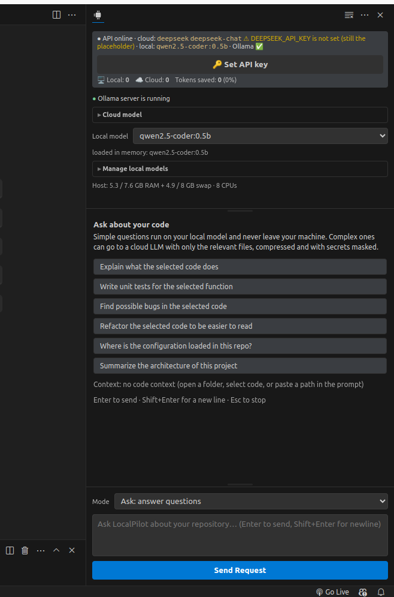

# TokenGuard — LocalPilot

**A local-first AI coding assistant for VS Code.** Simple questions are answered by a small model on your machine. Hard ones go to the cloud LLM of your choice, carrying only the relevant code with secrets redacted, and only after you agree.

TokenGuard is not another coding model. It sits in front of the models and decides **where** each question is answered and **how much** of your code goes with it.

<!-- Screenshots: add PNG/GIF files under extension/images/ and reference them here, e.g.

Marketplace READMEs must not use SVG images. -->

## Features

- **Automatic routing.** Each prompt gets a complexity score from 0 to 100. Simple and medium prompts run on a local [Ollama](https://ollama.com) model. Complex ones are offered to a cloud model, and you click **Use local** or **Use global**. A local answer can always be escalated, and the escalate button is highlighted when the local model is unsure.
- **Small, safe cloud context.** A codebase index picks only the code that matters for the question and fits it into the model's token budget (at most 16,000 tokens). It masks secrets such as API keys, private keys, and connection strings before anything leaves your machine. Each answer card shows how many tokens were sent compared with the full context.
- **Agent mode.** The agent explores the workspace, makes edits, and verifies them by running tests or scripts in a sandbox copy of the project. Every command waits for your approval. Changes open in the file itself with **Accept / Reject** on each hunk, and nothing is saved until you decide.
- **Bring your own provider.** Supports DeepSeek, Anthropic, OpenAI, any OpenAI-compatible endpoint (Groq, OpenRouter, self-hosted), and a mock provider for demos.
- **Ollama built in.** You can install Ollama, start it, and download, switch, or delete local models from the sidebar or the Command Palette.

## Requirements

- **VS Code** 1.82 or newer.
- **No Python setup needed.** On first run the extension creates a private virtual environment in its storage folder and installs the backend's dependencies. It uses Python 3.9+ if one is already installed (on `PATH` or in a standard location). Otherwise it downloads a standalone Python 3.12 (about 25–65 MB, checksum-verified) into its storage folder. First-run setup takes a minute or two and needs internet access once.
- **Ollama (optional)** for local answers. Without it, every prompt goes to the cloud provider. Run **TokenGuard: Install Ollama** to set it up. A 7B coding model such as `qwen2.5-coder:7b` is recommended for agent mode.
- **A cloud API key (optional)** for complex prompts. Run **TokenGuard: Set Cloud API Key**.

## Getting started

1. Install the extension and open the **LocalPilot** view in the Activity Bar.
2. Wait for the backend to start. The first run shows a progress notification while dependencies install.
3. Pick a cloud provider and model in the model panel, then set an API key with **TokenGuard: Set Cloud API Key**.
4. Optional: pick a local model. If it isn't downloaded yet, the extension offers to download it.
5. Ask a question. Selected code and the active workspace are used as context.

## Commands

| Command | What it does |
|---|---|
| TokenGuard: Open LocalPilot | Focus the chat sidebar |
| TokenGuard: Clear Chat | Clear the conversation |
| TokenGuard: Set / Clear Cloud API Key | Store or remove the key for the current provider (VS Code Secret Storage) |
| TokenGuard: Restart Backend | Restart the Python backend |
| TokenGuard: Show Backend Log | Open *Output > LocalPilot Backend* |
| TokenGuard: Install Ollama / Start Ollama Server | Set up the local runtime |
| TokenGuard: Download / Delete Local Model | Manage Ollama models |
| TokenGuard: Unload Local Models | Free the RAM used by loaded models |

## Extension settings

| Setting | Default | Description |
|---|---|---|
| `tokenguard.cloudProvider` | `deepseek` | Cloud provider: `deepseek`, `anthropic`, `openai`, `custom`, or `mock` |
| `tokenguard.cloudModel` | *(empty)* | Cloud model name. Empty uses the provider's default |
| `tokenguard.customBaseUrl` | *(empty)* | Base URL for the `custom` OpenAI-compatible provider |
| `tokenguard.cloudModelsAutoFetch` | `true` | Fetch the provider's model list for the picker (uses your API key) |
| `tokenguard.localModel` | *(empty)* | Ollama model for local answers, such as `qwen2.5-coder:7b` |
| `tokenguard.ollamaUrl` | `http://localhost:11434` | Ollama server URL |
| `tokenguard.autoStartOllama` | `true` | Start `ollama serve` if it isn't running |
| `tokenguard.stopOllamaOnExit` | `true` | Stop the Ollama process that TokenGuard started when VS Code closes |
| `tokenguard.preloadLocalModel` | `true` | Load the local model at startup so the first answer is fast |
| `tokenguard.agentInlineReview` | `true` | Open changed files with in-place Accept / Reject after an agent run |
| `tokenguard.apiUrl` | `http://localhost:8000` | Backend URL |
| `tokenguard.autoStartBackend` | `true` | Start the bundled backend (on a free port) when the chat view first opens |
| `tokenguard.backendPath` | *(empty)* | Development override: a `backend/` folder from a source checkout |
| `tokenguard.pythonPath` | *(empty)* | Use this interpreter instead of the managed virtual environment. It must already have the backend dependencies installed |

## Privacy

- **Local answers stay local.** Prompts routed to Ollama, and the code attached to them, never leave your machine.
- **Cloud requests are minimal and redacted.** Only the selected slice of code is sent, after secrets are masked, and only to the provider you configured. Complex prompts wait for you to click **Use global** before anything is sent.
- **API keys** are stored in VS Code Secret Storage. They are sent to the backend over `localhost` only, and from there only to the provider they belong to.
- **No telemetry.** TokenGuard collects no usage data and sends nothing to TokenGuard.
- **Other network access:**
  - On first run, `pip` downloads dependencies from PyPI. If no suitable Python is installed, a standalone CPython build is also downloaded from GitHub ([python-build-standalone](https://github.com/astral-sh/python-build-standalone)).
  - `tiktoken` downloads its tokenizer file once. If that download fails, the backend falls back to an estimate.
  - When `tokenguard.cloudModelsAutoFetch` is on, the provider's model list is fetched.
  - Ollama and its models are downloaded from ollama.com only when you ask.
- **On disk:** the codebase index is stored in `~/.cache/localpilot/index`. The Python environment (and the downloaded Python, if one was needed) is stored in VS Code's global storage folder for this extension.
- **Agent mode** runs commands only after you approve them, and only in a sandbox copy of the workspace with provider API keys removed from the environment. You choose whether credential-like files (`.env`, private keys) are copied into the sandbox.

## Troubleshooting

- **The backend doesn't start.** Open **TokenGuard: Show Backend Log**. First-run setup needs internet access (PyPI, plus GitHub if a Python has to be downloaded). Behind a proxy or offline, set `tokenguard.pythonPath` to a Python that already has the backend dependencies installed. Then run **TokenGuard: Restart Backend**.
- **Port 8000 is in use.** The extension starts its own backend on a free port, so this only matters for a backend you started yourself (e.g. `make backend` setting the port via `PORT`).
- **Local answers are slow.** Large contexts on CPU-only machines can take a while. Use a smaller model or ask with less code selected.

## License

[MIT](LICENSE). Third-party licenses are listed in [THIRD_PARTY_NOTICES.md](THIRD_PARTY_NOTICES.md).

Source code, issues, and the full design notes are at [github.com/tokenguard-labs/tokenguard](https://github.com/tokenguard-labs/tokenguard).
